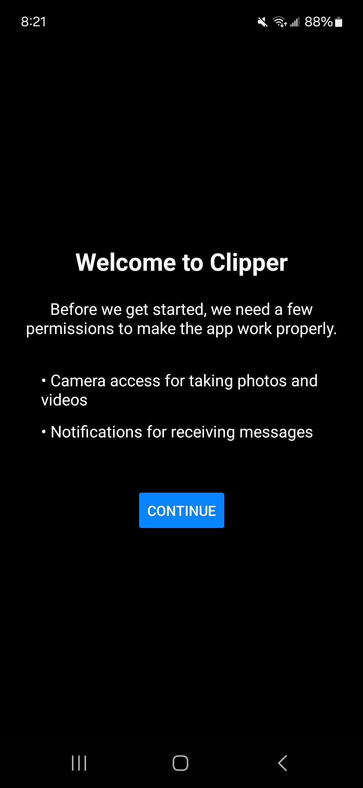
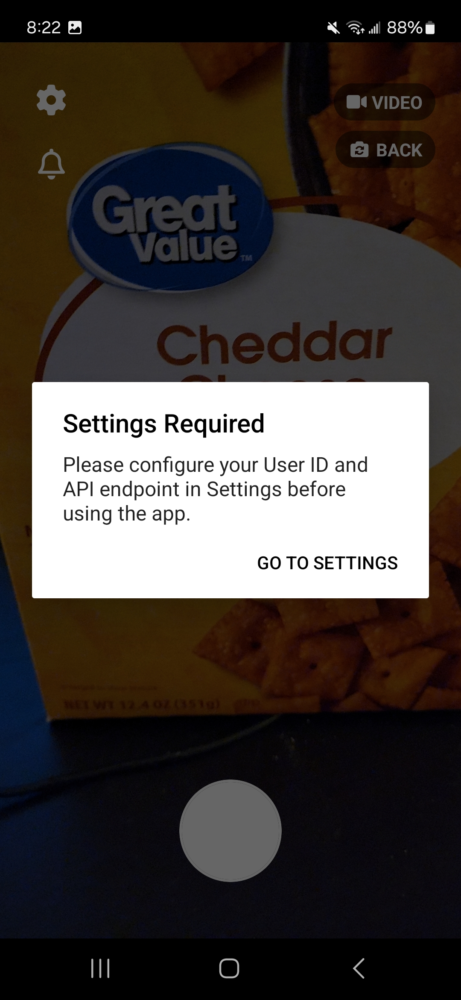
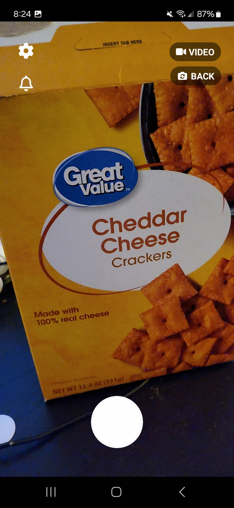
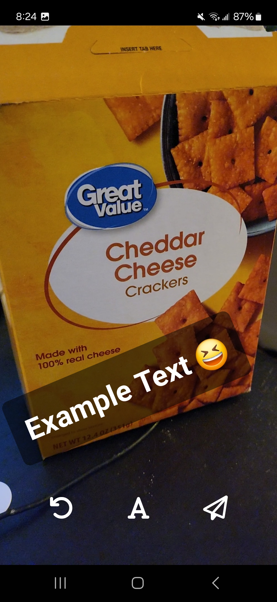

# Clipper App

This is a react native application built with Expo that allows users to capture photos or short videos and share them with others via a self-hosted [Clipper Server](https://github.com/clipper-camera/clipper-server) allowing for all data to be private and secure. Currrently the app is in a proof-of-concept phase. 


Key Features:
- Fast video capture and (slower) photo capture
- Drag to zoom into video
- Text overlays on videos and photos
- Sharing with multiple people
- Settings page to configure remote server & view uploads
- Notifications & page to view recieved messages


## Getting Started

Ensure you have the following setup to access in your commandline

- [Node.js](https://nodejs.org/) (LTS version recommended)
- [npm](https://www.npmjs.com/) or [Yarn](https://yarnpkg.com/)
- [Expo CLI](https://docs.expo.dev/get-started/installation/)
- [Expo Go](https://expo.dev/client) app on your mobile device (for testing)


Get all the dependencies
```bash
npm install
npx expo start
```

Now start the local development server
- Scan the QR code with your mobile device using the Expo Go app (Android) or the Camera app (iOS)
- Press 'a' to open on an Android emulator
- Press 'i' to open on an iOS simulator

```bash
npx expo start
npx expo run:android # if you want to use native client
```

To build the app for production via EAS build system

```bash
eas build --platform android
eas build --platform ios # (untested...)
```

### Building a local Android APK (no EAS)

This builds a standalone release APK with the JS bundle and all assets baked in — no Metro server or internet connection needed to run it. Requires the [Android SDK](https://developer.android.com/studio) and Java installed locally.

1. Bump the version in `app.json` (`expo.version` and `expo.android.versionCode`) — the app's own update checker and any reinstall over an existing copy both key off this.
2. Sync the version and regenerate the native project:
   ```bash
   npm run inject-version
   npx expo prebuild --platform android
   ```
3. Point Gradle at your Android SDK (one-time, not committed to git):
   ```
   # android/local.properties
   sdk.dir=C:\\Users\\<you>\\AppData\\Local\\Android\\Sdk
   ```
4. Build the release APK:
   ```bash
   cd android
   ./gradlew.bat assembleRelease   # ./gradlew assembleRelease on macOS/Linux
   ```
   The APK lands at `android/app/build/outputs/apk/release/app-release.apk`.

By default the release build is signed with the Gradle debug keystore (see `android/app/build.gradle`'s `signingConfigs.release`), which is fine for sideloading but not for a real Play Store release — swap in your own keystore before publishing anywhere public. Installing over an existing copy of the app requires it to have been signed with the same keystore, or you'll get an "app not installed" error and need to uninstall the old one first.


## Example Screenshots

   


